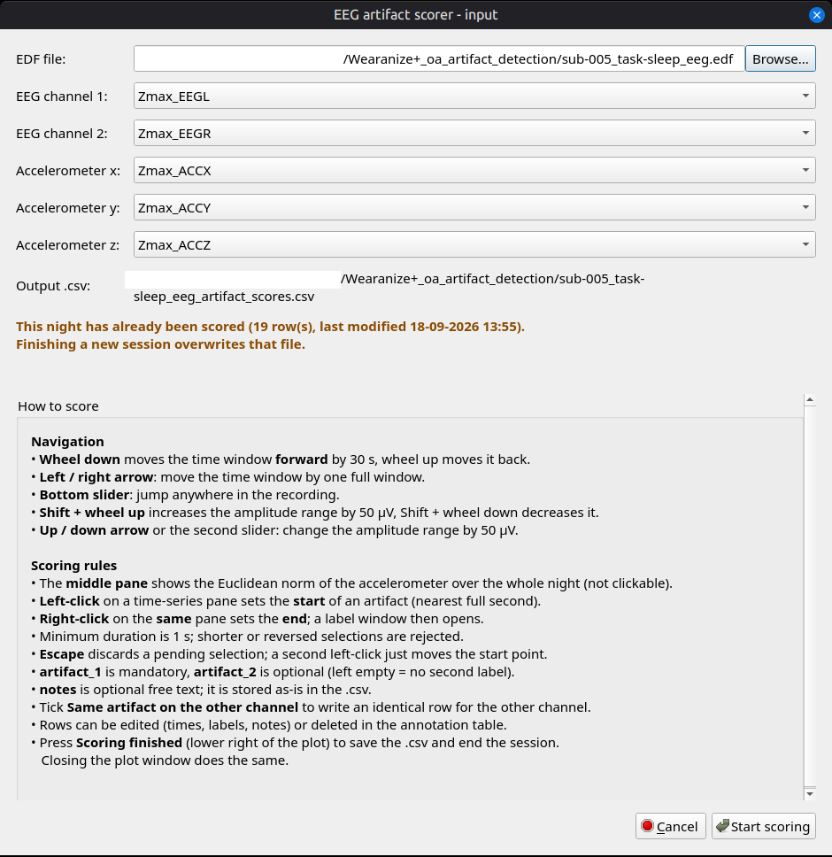
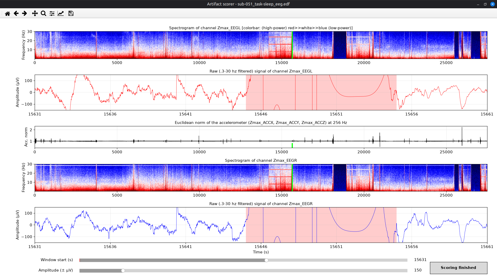
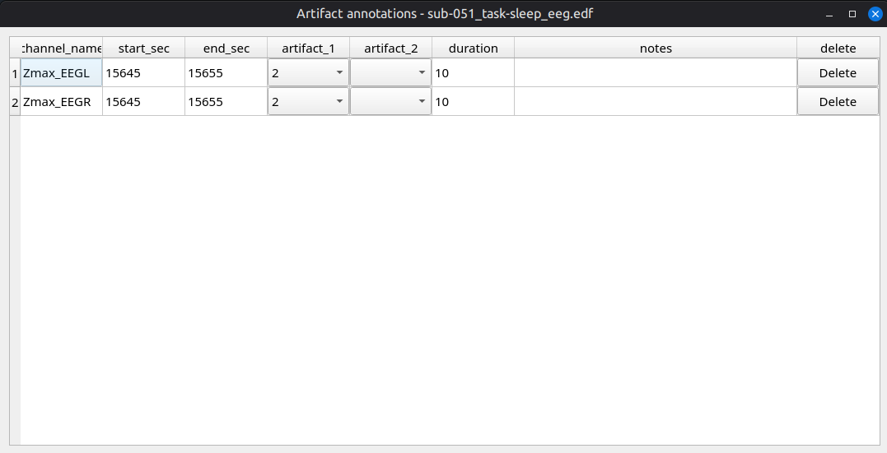

# EEG Artifact Scorer

A graphical tool for manual artifact scoring of two-channel EEG recordings in EDF format, written for whole-night sleep EEG data.

The app shows both EEG channels as scrollable time series alongside their full-night multitaper spectrograms and an accelerometer overview, lets you mark artifact segments with two mouse clicks, and writes the result to a `.csv` file next to the recording. It was written to produce the manual artifact labels used in [eegFloss](https://github.com/Niloy333/eegFloss), and the default label set matches the one used there.

No installation, no command-line arguments, no configuration file: open the script, run it, and pick a file in the window that appears. [Sample data](https://data.ru.nl/collections/di/dcmn/DSC_wrnzpoa_t0000925a_195); folder: *Wearanize+_OA_PlugNPlay_v1.1*.

---

## Overview

<p align="center">
  <br>
  <em>Input window: file selection, channel assignment, and the scoring rules.</em>
</p>

<p align="center">
  <br>
  <em>Scoring panel: spectrogram and time series per channel, accelerometer norm in the middle, scored segments shaded in red.</em>
</p>

<p align="center">
  <br>
  <em>Annotation table: live view of every scored segment, editable and deletable while scoring.</em>
</p>

---

## Features

- **Graphical input window** — browse for an EDF file, and the available channels are read from the header and offered as dropdowns. Two EEG channels and three accelerometer axes are selected per session; defaults are the Zmax channel names.
- **Five-pane scoring panel** — whole-night multitaper spectrogram ([`lspopt`](https://github.com/hbldh/lspopt)) and a 30 s scrolling time series for each EEG channel, plus the Euclidean norm of the accelerometer across the whole recording. A green marker on the full-night panes shows where the current window sits.
- **Two-click scoring** — left-click sets the start of an artifact, right-click on the same pane sets the end, both snapped to the nearest full second. A dialog then asks for the labels.
- **Two labels and a free-text note per segment** — `artifact_1` is mandatory, `artifact_2` and `notes` are optional. Invalid entries are rejected and re-prompted.
- **Score both channels at once** — a checkbox in the label dialog writes an identical row for the other channel, for artifacts that appear on both.
- **Live annotation table** — every segment appears immediately in a second window, where start and end times, labels, and notes can be edited and rows deleted while scoring continues.
- **Overwrite warning** — if the recording has already been scored, the input window says so, with the row count and date of the existing file, and asks for confirmation before starting.
- **Session ends deliberately** — the `Scoring finished` button (or closing the plot window) sorts the table, writes the `.csv`, and closes both windows.

---

## Requirements

Python 3.9 or newer, and:

| Package | Used for |
|---|---|
| `numpy` | signal handling |
| `pandas` | annotation table and `.csv` output |
| `scipy` | Butterworth band-pass filter |
| `matplotlib` | the scoring panel, sliders, and button |
| `PyQt5` | input window, label dialog, and annotation table |
| `pyedflib` | reading EDF files |
| `lspopt` | multitaper spectrograms |
| `joblib` | computing both spectrograms in parallel |

```bash
pip install numpy pandas scipy matplotlib PyQt5 pyedflib lspopt joblib
```

If you prefer to keep this separate from your main environment:

```bash
python -m venv artifactscorer
source artifactscorer/bin/activate        # Windows: artifactscorer\Scripts\activate
pip install numpy pandas scipy matplotlib PyQt5 pyedflib lspopt joblib
```

However, it is best to run it within a dedicated Miniconda environment; [follow these instructions](https://github.com/Niloy333/EEG-artifact-scorer/blob/base/run_in_conda_instructions.md).

---

## Usage

1. Clone or download this repository.
2. Open `eeg_2ch_artifact_scorer.py` in your editor of choice.
3. Optionally set `START_DIR` near the top to the folder holding your recordings, so the file browser opens there.
4. **Make sure the Qt backend is active.** In an IPython console, run `%matplotlib qt` once before running the script. The script stops with a clear message if any other backend is in use, since the sliders, dialogs, and mouse interaction all depend on Qt.
5. Run the script. Pick an EDF file, confirm the channel assignment, and press `Start scoring`.

### Navigation

| Action | Effect |
|---|---|
| Mouse wheel down / up | move the time window forward / back by one window (30 s) |
| Left / right arrow | same as the wheel |
| Bottom slider | jump anywhere in the recording |
| Shift + wheel, or a horizontal (thumb) wheel | change the amplitude range by 50 µV |
| Up / down arrow, or the second slider | same as above |

### Scoring

| Action | Effect |
|---|---|
| Left-click on a time-series pane | set the start of a segment |
| Right-click on the same pane | set the end, then enter the labels |
| `Escape` | discard a pending selection |
| A second left-click | move the start point instead of starting a new segment |

Segments shorter than 1 s, and selections where the end precedes the start, are rejected with a message in the console. A selection started on one channel must be finished on the same channel.

---

## Output

One `.csv` per recording, written beside the EDF file as `<edf_filename>_artifact_scores.csv`:

| Column | Content |
|---|---|
| `channel_name` | the channel the segment was scored on |
| `start_sec` | start of the segment, in seconds from the start of the recording |
| `end_sec` | end of the segment |
| `artifact_1` | primary artifact label (mandatory) |
| `artifact_2` | secondary artifact label (optional, empty if unused) |
| `duration` | `end_sec - start_sec`, in seconds |
| `notes` | free text (optional, empty if unused) |

Rows are sorted by channel and start time. Example:

```csv
channel_name,start_sec,end_sec,artifact_1,artifact_2,duration,notes
Zmax_EEGL,15645,15655,2,,10,
Zmax_EEGR,15645,15655,2,,10,
Zmax_EEGR,18012,18060,3,2,48,electrode pop
```

---

## Customizing the label set

The artifact labels are defined in one place near the top of the script:

```python
ART_RULES = {1: 'No data',
             2: 'High noise',
             3: 'Spiky',
             4: 'M-shaped',
             9: 'Artifact, but not defined above'}
```

Editing this dictionary is enough — the validator, both dropdowns in the annotation table, the label dialog, and the rules text shown in the input window all follow from it. The default set is the one used to build the training data for eegFloss.

Other settings worth knowing about, all grouped at the top of the script:

- `WINDOW_SEC` — width of the scrolling time-series window (default 30 s)
- `YLIM_INIT` and `AMP_STEP_UV` — starting amplitude range and the step size for the wheel and arrow keys
- `ACC_DEFAULTS` — accelerometer channel names pre-selected in the input window
- `MIN_DURATION_SEC` — shortest segment accepted

The time series is displayed unfiltered by default. A zero-phase Butterworth band-pass (`LOWCUT`, `HIGHCUT`, `FILT_ORDER`) is included and can be switched on by uncommenting the filtering line in the loading cell.

---

## Notes and limitations

- All signals must be in one EDF file.
- The two EEG channels must share a sampling rate; the three accelerometer channels must share one too, but it may differ from the EEG rate.
- The whole recording is loaded into memory. A full night of two EEG channels at 256 Hz is a few hundred MB at most, which is fine on a normal machine.
- The accelerometer overview is drawn as a min/max envelope rather than every sample, so the panel stays responsive on long recordings.
- The `.csv` is written only when the session ends properly. If the interpreter is interrupted or restarted while the panel is open, nothing is saved — but the table is still in the `ann_df` variable.
- Re-scoring a recording overwrites the previous `.csv`. The input window warns about this before you start.
- Feel free to adapt the script for the specific needs of your problem.
- LLMs were used to modify and customize it. Feel free to use and modify at your own risk.

---

## Citation

If you use this tool in your research, please cite the eegFloss paper:
```bibtex
@article{sikder2025eegfloss,
  title     = {eegFloss: A Python package for refining sleep EEG recordings using machine learning models},
  author    = {Sikder, Niloy and Zerr, Paul and Jafarzadeh Esfahani, Mahdad and Dresler, Martin and Krauledat, Matthias},
  journal   = {arXiv preprint arXiv:2507.06433},
  year      = {2025},
  doi       = {10.48550/arXiv.2507.06433},
  url       = {https://arxiv.org/abs/2507.06433},
}
```

---

## License

MIT License.
